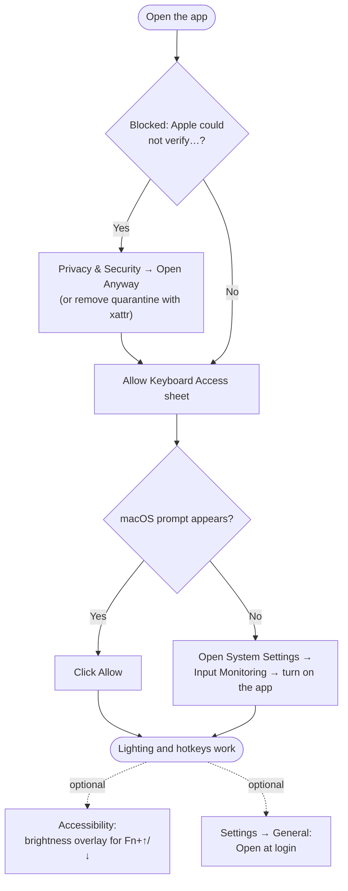

# Installation

- [Requirements](#requirements)
- [Install from a disk image](#install-from-a-disk-image)
- [Build and install](#build-and-install)
- [Making a disk image](#making-a-disk-image)
- [Permissions](#permissions)
- [Code signing](#code-signing)
- [Updating](#updating)
  - [Upgrading from 1.x](#upgrading-from-1x)
- [Uninstalling](#uninstalling)

## Requirements

| | |
| :--- | :--- |
| **macOS** | 14 Sonoma or later |
| **Hardware** | ASUS laptop with the ITE Aura USB keyboard controller. See [compatible laptops](HACKINTOSH.md#compatible-laptops). |
| **Toolchain** | Swift 5.9 or later, from Xcode or the Command Line Tools (`xcode-select --install`) |

## Install from a disk image

1. Download `ROG-Gaming-Center-<version>.dmg` from [Releases](https://github.com/sritulasiram/rog-gaming-center-hackintosh/releases) and open it.
2. Drag **ROG Gaming Center** onto the **Applications** shortcut.
3. Eject the disk image and open the app from Applications.

The app isn't notarized by Apple, so the first launch is blocked with "Apple could not verify…". To open it:

- Open **System Settings → Privacy & Security**, scroll to the message about ROG Gaming Center and click **Open Anyway**, or
- Remove the download quarantine in Terminal:

  ```bash
  xattr -dr com.apple.quarantine "/Applications/ROG Gaming Center.app"
  ```

Then allow [Input Monitoring](#input-monitoring) when the app asks. The disk image doesn't install the CLI; see [Installing the CLI](#installing-the-cli).

### First launch at a glance



## Build and install

```bash
git clone https://github.com/sritulasiram/rog-gaming-center-hackintosh.git
cd rog-gaming-center-hackintosh
./build.sh --install
```

`build.sh --install`:

1. Builds the app and the `rogauracore` CLI in release mode with SwiftPM.
2. Assembles `ROG Gaming Center.app` and signs it (see [Code signing](#code-signing)).
3. Quits a running copy and resets the app's Input Monitoring record so macOS asks again.
4. Replaces `/Applications/ROG Gaming Center.app`.
5. Copies `rogauracore` to `/usr/local/bin` if that folder is writable.
6. Launches the app.

To only build, run `./build.sh`. The results go to `./build/`:

```
build/ROG Gaming Center.app
build/rogauracore
```

### Installing the CLI

If `/usr/local/bin` isn't writable, the CLI is skipped. It's also bundled inside the app, so you can install it from there:

```bash
sudo cp "/Applications/ROG Gaming Center.app/Contents/Resources/rogauracore" /usr/local/bin/
```

## Making a disk image

```bash
./make-dmg.sh             # package the existing build (builds first if needed)
./make-dmg.sh --rebuild   # always rebuild first
```

The result is `build/ROG-Gaming-Center-<version>.dmg`: the app, an Applications shortcut, and the app icon as the volume icon. If an Apple Development certificate is found (or `SIGNING_IDENTITY` is set), the disk image is signed with it. The version comes from the app's `Info.plist`, set in `build.sh`.

## Permissions

| Permission | Needed for | Required |
| :--- | :--- | :--- |
| **Input Monitoring** | Writing to the keyboard lighting controller and reading the ROG and Fn keys | Yes |
| **Accessibility** | Showing the system brightness overlay when you press Fn+↑/↓ | No |

### Input Monitoring

On first launch the app shows **Allow Keyboard Access**:

1. Click **Allow Access**. macOS shows its own prompt the first time.
2. If macOS doesn't prompt, or you denied it earlier, click **Open System Settings**. Go to **Privacy & Security → Input Monitoring** and turn on **ROG Gaming Center**.
3. Switch back to the app. It detects the change automatically.

You can check the state at any time under **Status → Permissions**.

The CLI runs inside your terminal app, so the terminal (Terminal, iTerm, VS Code…) needs Input Monitoring for `rogauracore` to write to the keyboard.

## Code signing

macOS ties permission grants to an app's code signature. `build.sh` looks for an **Apple Development** certificate in your keychain and uses it if found. Otherwise it signs ad hoc.

| Signing | What it means for you |
| :--- | :--- |
| Apple Development certificate | Input Monitoring stays granted across rebuilds. |
| Ad hoc (no certificate) | Every rebuild looks like a new app, so you grant Input Monitoring again after each install. |

To use a specific identity:

```bash
security find-identity -v -p codesigning          # list identities
SIGNING_IDENTITY="Apple Development: you@example.com (TEAMID)" ./build.sh --install
```

A free Apple ID added in Xcode → Settings → Accounts creates an Apple Development certificate.

The app is deliberately **not sandboxed** and doesn't use the hardened runtime. Both get in the way of raw HID feature reports to a vendor device. See `ROGGamingCenter.entitlements`.

## Updating

```bash
git pull
./build.sh --install
```

Your settings, presets and display profile are kept. Settings from 1.x are migrated automatically on first launch.

> **You'll need to allow Input Monitoring again after every update.** `./build.sh --install` resets the app's Input Monitoring record on purpose, so macOS asks fresh instead of silently denying a changed build. Until you allow it, the menu bar shows "Keyboard access needed" and lighting and hotkeys don't respond. This happens even with an [Apple Development certificate](#code-signing).

When updating from a disk image instead, quit the app, replace it in Applications, and open it again. If the keyboard stops responding, turn **ROG Gaming Center** off and on in Input Monitoring.

### Upgrading from 1.x

2.0 is a rebuild and needs macOS 14 Sonoma or later. Settings, saved presets and the display profile are migrated automatically on first launch. Two things changed:

- The **battery charge limit** was removed.
- The ROG key's "toggle popover" action now shows or hides the window.

See the [changelog](../CHANGELOG.md) for the full list.

## Uninstalling

1. Quit the app: menu bar icon → **Quit ROG Gaming Center**, or ⌘Q.
2. If you turned on **Open at login**, turn it off first in **Settings → General**, or remove it in System Settings → General → Login Items.
3. Remove the app, CLI, settings and permission record:

```bash
rm -rf "/Applications/ROG Gaming Center.app"
sudo rm -f /usr/local/bin/rogauracore
defaults delete com.asus.roggamingcenter
tccutil reset ListenEvent com.asus.roggamingcenter
```

The keyboard keeps the last lighting it was given until the next sleep or restart. Quitting the app restores your normal display calibration.
